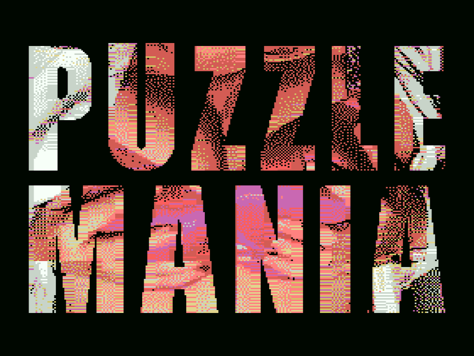

# Puzzle Mania XXXL (MSXdev26)



Two puzzle games for the plain **MSX1** (16 KB RAM) on a **NEO16** cartridge: a **sliding puzzle** (twelve photos, 3×3 up to 6×6) and **memory** (twenty cards, ten pairs). Finish a puzzle for a jingle, confetti and a video.
An **MSX2 or later** gives every photo better colours; an **SCC** cartridge gives higher quality music. The game plays itself when left alone (attract mode).
Keyboard or joystick (port 1). Freeware. Contains nudity (18+).

There is also a **turbo R version** with PCM sound: [puzzle-mania-turbor](https://github.com/TFHFony/puzzle-mania-turbor).

**Manual:** [docs/MANUAL.md](docs/MANUAL.md) (the screenshots are in `docs/images`).

## Releases

The ROMs and the PDF manual are attached to the [releases](../../releases), they are not in the repository.

| file | |
|---|---|
| `PuzzleManiaXXXL_v1.0_128MB[NEO16].rom` | the full version (123 MB): full length 10 fps reward videos, a 30 s video with music in the letters of the title, a palette per photo on an MSX2 or later, 16 kHz music on an SCC. Needs a cartridge / emulator that maps more than 64 MB. |
| `PuzzleManiaXXXL_v1.0_15MB[NEO16].rom` | the small version (15 MB): very short reward videos, no SCC music. |
| `PuzzleMania_checksums.txt` | sizes and MD5 |

openMSX: `openmsx -machine Philips_VG_8020 -cart "PuzzleManiaXXXL_v1.0_15MB[NEO16].rom" -romtype NEO-16`

## Keys and joystick
cursors + SPACE choose, ESC back, SELECT 50/60 Hz (MSX2+), H solution (hold), N numbers/moves/time (hold), T hint, L tile lines (off/thick/thin), C control (arrows/cursor).
Joystick port 1: stick = cursors, fire A = SPACE, fire B = H, fire A + left = ESC.

## Build
```
python tools/build_game.py --out PuzzleMania_128MB.rom --titlevideo --msx2pal --scc --release V1.0                 # the full version
python tools/build_game.py --out PuzzleMania_15MB.rom --titlevideo --msx2pal --clipframes 30 --release V1.0         # the small version
```
Needs Python 3 (numpy, scipy, pillow), ffmpeg and [sjasmplus](https://github.com/z00m128/sjasmplus) (its path is set in `tools/build_game.py`). The first build encodes everything (an hour or more on 8 cores) and caches the result in `work/`.

The source media (the photos/videos in `Videos/`, the music in `Music/`, `PM.wav`, `PM-Menu.mp3`) are **not** in the repository. The tools expect them in the project folder
(the title video is `Videos/PM-LOGO.mp4`). Only what is needed to build the game and the manual is published here.

## Layout
* `game/` the Z80 program (sjasmplus): `pm.asm` + `equ.inc core.asm music.asm screens.asm menu.asm puzzle.asm puzzle2.asm job.asm vplay.asm` (bank 0, 16 KB),
  `plr.asm`/`player.asm` the PSG sample player that runs from RAM, `plr_scc.asm` the 16 kHz SCC player, `sndplay.asm` the jingle player, `spec.asm` the specs screen,
  `msx2.asm` the palette per photo, `scc.asm` the SCC, `extra.asm` the attract mode, `memory.asm` / `memplay.asm` / `mem.asm` the memory game (own overlay bank),
  `jigplay.asm` the jigsaw outro, `fonyplay.asm` the FONY film intro, `ovl.asm`/`video.asm` the video player in its own overlay bank, `wtest.asm` the VDP wait state test, `diag.asm` the self-test.
  Generated files (`gen.inc`, `psgtab.inc`, `clk.inc`, `cfg.inc`, `slots.inc`, `tvplay*.inc`, `*.bin`, `*.lst`, `*.sym`, ...) are not in the repository.
* `tools/` `build_game.py` (pictures, music, ROM layout, assembly), `build_all.py`, `encode_clips.py` (reward videos), `stills.py` (stills, choice in `choices.json`),
  `music.py` + `jingle.py` (PSG and SCC samples), `palette_opt.py` (a palette per photo for the MSX2 version), `screens.py`, `menu_logo.py`, `xxxl_logo.py`, `memory_cards.py`,
  `title_video.py` + `gen_tvplay*.py` (the title video and its player), `fony_video.py` + `fony_intro.py` + `gen_fony*.py` (the FONY film), `jigsaw.py`, `gen_slots*.py` (the sample players; the calibration is in the `.json` files).
* `assets/` the logos and the FONY jingle that the build needs.
* `docs/` manual and screenshots.

ROM layout: bank 0 code | 1 + 10p + k photo p (plain+thumbnail, buttons, thick lines 3..6, thin lines 3..6) | 91 title, 92 FONY, 93-95 how to play, 96 credits, 97 self-test |
98 first picture of the title video, 99.. menu music, puzzle music | 254 the player block (copied to RAM C400h) | 255 video player overlay | 256.. (128 MB version) the stream of the title video, one bank per frame | then the reward videos (frames packed: 4 frames in 3 banks)

## Credits
Coding The File-Hunter & Claude · GFX The File-Hunter & Tittygram · Music The File-Hunter & Solmi AI
