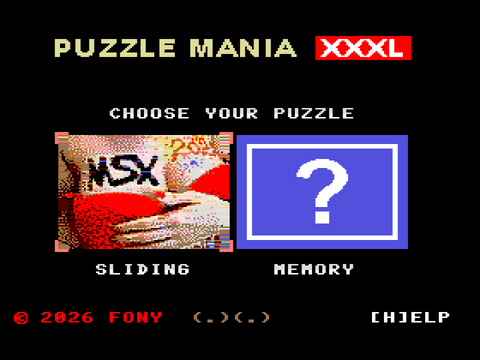
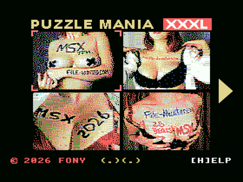
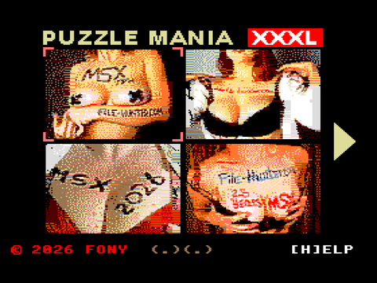
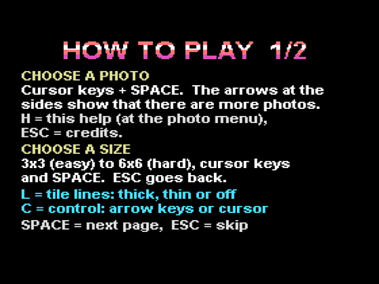
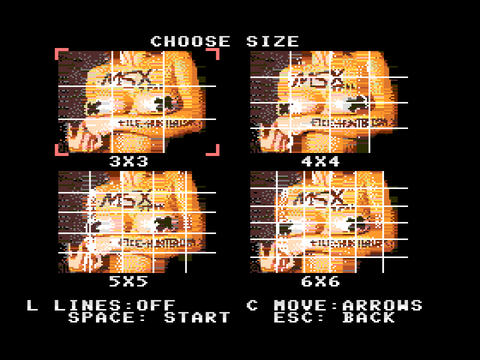
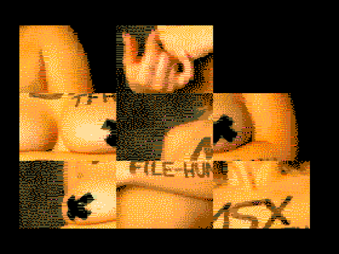
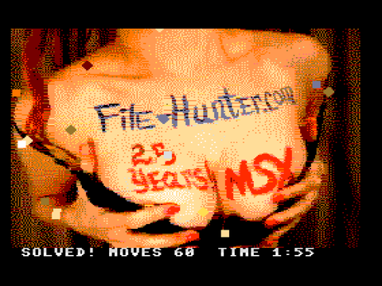
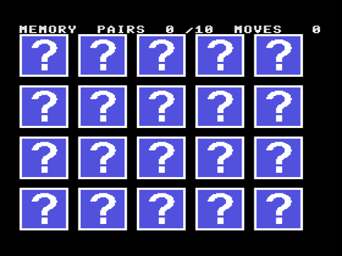
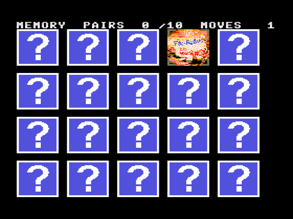
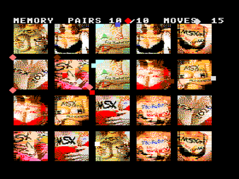

# Puzzle Mania XXXL — manual

*Two puzzle games for the MSX — MSXdev26 entry — freeware*

> **Adult content:** the photos and videos contain nudity. For players of 18 and older.

---

## 1. The game

Puzzle Mania has two games, both with the same nine photos:

- **Sliding puzzle** — the photo is cut into pieces and shuffled. Slide the pieces back into place. You choose the size: 3×3 (easy) up to 6×6 (hard).
- **Memory** — twenty cards lie face down. Turn two at a time and find the ten pairs of photos.

Finish a puzzle and you get a jingle, falling confetti and a video of the photo.

You play with the keyboard or with a joystick in port 1.

## 2. What you need

| | |
|---|---|
| **Minimum** | Any **MSX1** with a **NEO16** cartridge (the 128 MB ROM needs a cartridge or emulator that can read that much). 16 KB RAM is enough. 50 Hz and 60 Hz machines both work. The music plays on the standard sound chip (PSG). |
| **MSX2, MSX2+, turbo R** | **Better colours:** every photo gets its own set of colours, so skin tones and details look much more natural. |
| **SCC cartridge** (in another slot) | **Higher quality music:** the music and jingles play at twice the sound quality. |

The game finds out by itself what your machine can do. Nothing needs to be set.

| MSX1 | MSX2 or later |
|---|---|
|  |  |

## 3. Starting

After the FONY intro film and the PUZZLE MANIA XXXL title you arrive at the screen where you choose your puzzle. Press **SPACE** to skip the intro at any time.

Use **left and right** to choose **SLIDING** or **MEMORY** (the yellow corners show your choice) and press **SPACE**.

| | |
|---|---|
|  |  |

At the bottom of this screen and the photo menu: **H** shows the help, **ESC** shows the credits.

## 4. Sliding puzzle

**Choose a photo.** Use the cursor keys; the arrow at the side shows that there are more photos. Press **SPACE** to choose.

**Choose a size.** 3×3 to 6×6, then **SPACE** to start. **ESC** goes back. Two options can be set here and during the game:

- **L** — lines between the pieces: off, thick or thin.
- **C** — how you move: **ARROWS** (an arrow key slides the piece next to the gap in that direction) or **CURSOR** (move the four yellow corners to a piece and press SPACE to slide it).

**Play.** Only a piece next to the empty square can move. The picture is complete when all pieces are back in place.

| | |
|---|---|
|  |  |
| A shuffled 3×3 puzzle | Solved: your moves and time are shown |

When you finish you hear the jingle, confetti falls over the picture and the video starts. Press **SPACE** to go back to the menu.

**Need help?** Hold **H** to look at the finished photo. Hold **N** to see the number of every piece, plus your moves and time. Press **T** to see which piece belongs in the gap.

## 5. Memory

Twenty cards, ten pairs. Move the yellow corners over a card and press **SPACE** to turn it, then turn a second card. If the two photos are the same, the pair stays face up. If not, both cards turn back — try to remember where they were! The top line shows your pairs and moves.

| | |
|---|---|
|  |  |

When the last pair is found the board stays on the screen, the jingle plays and confetti falls. Press **SPACE** to see the video of the last pair, and **SPACE** again to go back to the choice screen.

## 6. Keys

| Key | What it does |
|---|---|
| **Cursor keys** | Choose, move the cursor, slide a piece |
| **SPACE** or **RETURN** | Choose, turn a card, next page, stop the video |
| **ESC** | Go back; at the choice screen: the credits |
| **H** | Help (at the menus); hold in the sliding puzzle: look at the finished photo |
| **N** (hold) | Sliding puzzle: piece numbers, moves and time |
| **T** | Sliding puzzle: hint |
| **L** | Sliding puzzle: lines off, thick or thin |
| **C** | Sliding puzzle: move with ARROWS or with the CURSOR |
| **SELECT** | Switch between 50 and 60 Hz (MSX2 and later) |

**Joystick (port 1):** the stick works as the cursor keys, **fire A** as SPACE, **fire B** (hold) as H, **fire A and left together** as ESC.

## 7. Attract mode

Leave the game alone for a while and it plays by itself, alternating between the sliding puzzle and memory. Press any key to take over.

## 8. Credits

| | |
|---|---|
| Coding | The File-Hunter & Claude |
| GFX | The File-Hunter & Tittygram |
| Music | The File-Hunter & Solmi AI |

## 9. Freeware licence

**PUZZLE MANIA — freeware.**

You may download, play, copy and distribute this game, free of charge, as long as the files are kept unchanged and complete (ROM files, manual) and no fee is asked for it. The game must always be freely obtainable in its full version.

The authors keep the ownership of the game, the pictures, the music and the videos; all rights that are not explicitly granted here are reserved. During the MSXdev compo the game is exclusive to the MSXdev website; afterwards the authors may redistribute it or sell it.

The game is provided "as is", without any warranty. Use it at your own risk.

*The game contains nudity (photos and videos) and is meant for adults (18+).*
